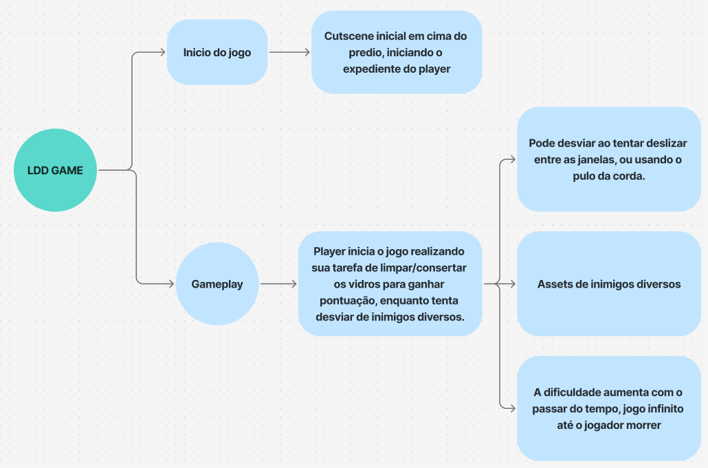

# Apex Grappler: Operação Vertical



## Premissa e Universo

Em **New Tokyo (233 d.IA — depois da Inteligência Artificial)**, a automação corporativa substituiu quase toda a força de trabalho humana, relegando os poucos trabalhadores restantes às funções mais insalubres e letais da metrópole — onde o custo de reposição de um robô supera o valor da vida humana.

Você assume o papel de um alpinista industrial contratado por uma terceirizada sub-paga para realizar a manutenção externa do **Apex-01**, o maior arranha-céu corporativo da cidade, mantido pela megacorporação **Neo-Apex**. Suspenso a centenas de metros do chão, sua missão é limpar a fuligem ácida e consertar painéis de vidro estilhaçados por conflitos urbanos enquanto desvia de balas perdidas e drones de segurança.

- **Ambiente**: New Tokyo — Arranha-céu Corporativo Apex-01
- **Época**: 233 d.IA (depois da IA)
- **Gênero**: Arcade 2D de Ação, Sobrevivência Vertical e Física Pendular
- **Crítica Social**: O sistema de pontuação representa sua **Avaliação de Eficiência Corporativa** em tempo real. Na cidade que nunca dorme, trabalhadores são engrenagens descartáveis: se sua produtividade cair abaixo da meta, seu contrato é rescindido instantaneamente.

---

## Mecânicas Principais

### 1. Sistema de Ancoragem por Gancho (`player_anchor_system.py`)
- **Até 3 Âncoras Simultâneas**: Mire com o cursor e dispare ganchos magnéticos nas vigas e estruturas metálicas da fachada dentro do alcance máximo.
- **Física Pendular na Corda Ativa**: Suba, desça e ganhe impulso lateral balançando na corda conectada.
- **Salto e Link Aéreo**: Desconecte-se da âncora atual saltando no ar com conservação de momentum e reconecte-se (`Link`) a outra âncora previamente plantada que esteja alinhada verticalmente (eixo Y).
- **Risco de Queda Fatal**: Errar o cálculo de alinhamento durante uma troca aérea resulta em queda livre e rescisão imediata de contrato.

### 2. Limpeza e Conserto Contextuais (`player_cleaning_system.py`)
- **Botão Único Contextual (`[E]`)**: O sistema detecta automaticamente o estado do painel de vidro sob o alpinista:
  - **Janela Suja (Limpeza)**: Duração de **1.5 segundos** (+100 pontos e +15% de eficiência).
  - **Janela Quebrada (Conserto a Laser)**: Duração de **3.5 segundos** (+250 pontos e +30% de eficiência).
- **Preservação de Progresso**: Durante a execução, o alpinista fica estabilizado e vulnerável. Caso interrompa a ação para desviar de um tiro ou seja atingido, o progresso da janela é preservado e pode ser retomado exatamente de onde parou.

### 3. Barra de Eficiência Corporativa e Vitalidade (`player_health_and_score.py`)
- **Vitalidade (HP)**: O trabalhador possui **3 corações** de vida. Cada impacto de projétil ou drone reduz 1 coração, aplica recuo físico (*knockback*) no pêndulo, interrompe ações em andamento e concede uma breve janela de invulnerabilidade.
- **Eficiência Corporativa**: Barra que decai continuamente ao longo do turno (e **2x mais rápido** se o trabalhador ficar ocioso). Se chegar a `0%`, ocorre Game Over por *Desempenho Insuficiente*.

### 4. Ameaças Dinâmicas (`hazard_spawner.py`, `stray_bullet.py`, `patrol_drone_ai.py`)
- **Balas Perdidas com Telegrafagem Laser**: Disparos cruzam a fachada precedidos por uma mira laser de aviso sonoro e visual (`~0.66s`), exigindo reflexo rápido na corda.
- **Curva de Dificuldade Progressiva**: Conforme a pontuação e a altitude avançam, a frequência e a velocidade das ameaças urbanas escalam dinamicamente.
- **Drones de Patrulha (`patrol_drone_ai.py`)**: Unidades autônomas de vigilância que patrulham setores da fachada, escaneiam a área com feixes de alerta e disparam contra o trabalhador.

### 5. Power-Ups Pré-Partida (`powerup_system.py`)
Antes de iniciar o expediente no menu principal, o jogador pode selecionar um equipamento corporativo de suporte:
1. **Nenhum (`[1]`)**: Turno padrão sem modificadores.
2. **Escudo Reativo (`[2]`)**: Absorve o primeiro impacto de projétil sem perda de HP e sem interromper o serviço de limpeza/reparo.
3. **Rodo Turbo (`[3]`)**: Aumenta em **+50%** a velocidade de limpeza e conserto de janelas.
4. **Estabilizador Corporativo (`[4]`)**: Reduz em **-30%** o dreno da barra de Eficiência Corporativa e concede **+25%** de bônus na pontuação.

### 6. Trilha Sonora Dinâmica por Setor (`audio_manager.py`)
O sistema de áudio gerencia efeitos sonoros chiptune e transições dinâmicas da trilha sonora *Electric Pulse* de acordo com a altitude no edifício **Apex-01**:
- **Setores Baixos**: Ambientação industrial densa e frenética.
- **Setores Médios**: Pulso sintético corporativo de média altitude.
- **Setores Altos (Apex)**: Atmosfera neon de alta tensão no topo da megatorre.

---

## Tabela Completa de Controles

O jogo conta com suporte multiplataforma integrado para **Desktop (Teclado + Mouse)**, **Dispositivos Móveis (Touch Virtual na Tela)** e **Gamepad (USB/Bluetooth)**.

| Ação | Desktop (Teclado + Mouse) | Mobile / Touch (`touch_controls.py`) | Gamepad |
| :--- | :--- | :--- | :--- |
| **Mirar Gancho** | Cursor do Mouse | Toque direto na fachada | Direcional / Cursor |
| **Plantar Âncora / Link no Ar** | `Clique Esquerdo` | Toque na fachada (fora da UI) | Gatilho / Toque |
| **Recolher Âncora** | `Clique Direito` ou `R` | Botão virtual `[R]` ou toque na âncora | Botão `Y` |
| **Subir / Descer na Corda** | `W` / `S` ou `Seta Cima` / `Seta Baixo` | D-Pad Virtual (`Cima` / `Baixo`) | `D-Pad Cima` / `Baixo` |
| **Balançar na Corda (Esquerda/Direita)** | `A` / `D` ou `Seta Esquerda` / `Seta Direita` | D-Pad Virtual (`Esquerda` / `Direita`) | `D-Pad Esquerda` / `Direita` |
| **Saltar da Corda / Link Aéreo** | `Espaço` | Botão virtual `SALTO` | Botão `A` |
| **Limpar / Consertar Janela** | `E` (segurar) | Botão virtual `[E]` (segurar) | Botão `X` (segurar) |
| **Selecionar Power-Up (Menu)** | Teclas `1`, `2`, `3`, `4` | Toque no card do Power-Up | `D-Pad` + Botão `A` |
| **Alternar Interface Touch** | Tecla `T` | Botão `[TOUCH]` / `[MOUSE]` no topo | — |
| **Mutar / Desmutar Áudio** | Tecla `M` | Botão de áudio na interface | — |
| **Exibir / Ocultar Ajuda** | Tecla `H` | Toque no ícone de ajuda | — |
| **Iniciar / Retentar Turno** | `Espaço`, `Enter`, `R` ou `Clique` | Toque na tela | Botão `A` ou `Start` |

---

## Arquitetura do Projeto

Todos os módulos principais residem no diretório `app/`:

| Módulo (`app/`) | Descrição e Responsabilidade |
| :--- | :--- |
| `main.py` | Ponto de entrada da aplicação Pyxel (`320x180`), gerenciando o loop principal e a máquina de estados entre Menu e Gameplay. |
| `constants.py` | Constantes globais de estados da aplicação (`STATE_MAIN_MENU`, `STATE_GAMEPLAY`). |
| `main_menu.py` | Tela inicial interativa com seleção de Power-Ups pré-partida, instruções e início de turno. |
| `gameplay.py` | Orquestrador do turno de jogo: câmera suave com paralaxe, atualização de entidades, colisões, áudio e HUD. |
| `player.py` | Entidade principal do alpinista industrial, integrando animações 32x32, controles multiplataforma e sistemas de física. |
| `player_anchor_system.py` | Gerenciamento das 3 âncoras, física pendular na corda ativa, mira balística, salto, link aéreo no eixo Y e queda fatal. |
| `player_cleaning_system.py` | Detecção contextual de janelas sujas/quebradas, timers de limpeza (1.5s) e reparo (3.5s), partículas e preservação de progresso. |
| `player_health_and_score.py` | Controle dos 3 corações de HP, invulnerabilidade temporária, barra de Eficiência Corporativa, placar e tela de Game Over. |
| `building_generator.py` | Geração procedural da fachada do edifício Apex-01 (colunas de janelas, vigas metálicas e estados dos vidros). |
| `hazard_spawner.py` | Gerenciador de ameaças urbanas com curva de dificuldade progressiva, coordenando balas perdidas, drones e faíscas de impacto. |
| `stray_bullet.py` | Projéteis perdidos com fase de telegrafagem laser (`PHASE_TELEGRAPH`) seguida de disparo em alta velocidade (`PHASE_FLYING`). |
| `patrol_drone_ai.py` | Inteligência artificial dos Drones de Patrulha corporativos (movimentação por setor, escaneamento de alvo e disparo de advertência). |
| `powerup_system.py` | Sistema de Power-Ups pré-partida (*Escudo Reativo*, *Rodo Turbo* e *Estabilizador Corporativo*) e aplicação de seus modificadores. |
| `audio_manager.py` | Gerenciador de efeitos sonoros chiptune e trilha sonora dinâmica adaptada por setor de altitude (Baixo, Médio e Apex) com controle de mute (`M`). |
| `touch_controls.py` | Interface de controles virtuais na tela (D-Pad e botões de ação) para dispositivos móveis/web e integração com Gamepad. |

---

## Como Rodar, Testar e Exportar para Web

### 1. Configurar Ambiente e Executar Localmente

```bash
# Criar e ativar o ambiente virtual Python
python -m venv venv
source venv/bin/activate  # No Windows: venv\Scripts\activate

# Instalar as dependências do projeto
pip install -r app/requirements.txt

# Iniciar o jogo
python app/main.py
```

### 2. Executar a Suíte de Testes Automatizados

O projeto conta com testes automatizados cobrindo física de ancoragem, limpeza, saúde/pontuação, ameaças, controles e documentação:

```bash
pytest
```

### 3. Exportar para Web (HTML5 / Pyxel Web)

O motor Pyxel permite empacotar o jogo em um arquivo `.pyxapp` e gerar uma página HTML autossuficiente para execução direto no navegador (Desktop e Mobile):

```bash
# 1. Empacotar o diretório app/ em um pacote executável Pyxel (.pyxapp)
pyxel package app app/main.py

# 2. Converter o pacote .pyxapp em um arquivo HTML autocontido
pyxel app2html app.pyxapp
```

O arquivo `app.html` gerado pode ser aberto diretamente no navegador ou hospedado em serviços estáticos (como GitHub Pages ou Itch.io).

---

## Créditos e Licenças

- **Desenvolvimento, Game Design e Áudio Chiptune**: Nícolas Pitz
- **Motor de Jogo**: [Pyxel](https://github.com/kitao/pyxel) por Takashi Kitao — distribuído sob licença **MIT**.
- **Trilha Sonora (`assets/Audio/SoundTrack/`)**: Pacote *Electric Pulse* por **DavidKBD** (músicas cyberpunk/synthwave licenciadas para uso gratuito/royalty-free).
- **Tipografia (`assets/Font/webfontkit-BoldPixels/`)**: Fonte pixel art **BoldPixels** criada por **Yūki (@yukipixels)** — licenciada sob **CC BY-SA 4.0**.
- **Referências e Inspirações**:
  - [Cyberpunk 2077](https://store.steampowered.com/app/1091500/Cyberpunk_2077/)
  - [Blade Runner](https://pt.wikipedia.org/wiki/Blade_Runner)
  - [Make Small Games](https://abagames.github.io/joys-of-small-game-development-en/fun_to_make_small_games.html)
